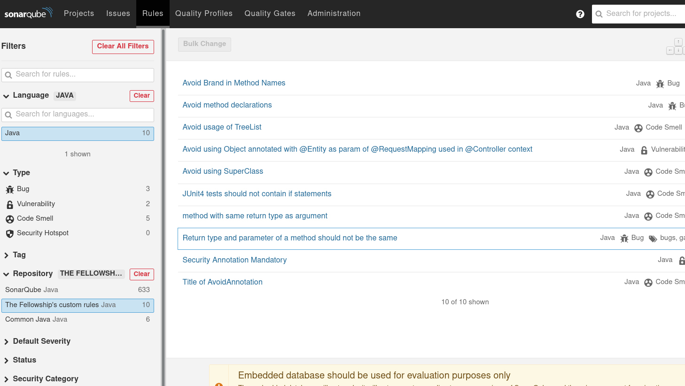
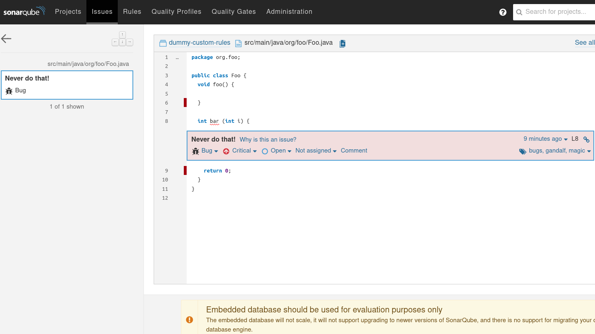

# Testing a custom plugin

After [registering the rule](registering-the-rule.md), test it on a project using a local SonarQube instance.

> The standalone POM is pinned for SonarQube 10.6. Use a compatible instance for the tutorial, or adapt the dependencies for your target release as described in [Getting started](getting-started.md#looking-at-the-pom). See the [SonarQube downloads page](https://www.sonarqube.org/downloads/) for available releases.

1. Rebuild the plugin using the [standalone Maven command](getting-started.md#looking-at-the-pom). The build runs the tests and produces **java-custom-rules-example-1.0.0-SNAPSHOT.jar** in the example project's **target** directory.
2. Copy the JAR into the **extensions/plugins** directory of your SonarQube installation. Restart the instance, sign in as an administrator, and open the **Rules** tab.
3. Filter by **Java** and by the repository **The Fellowship's custom rules** (or **MyCompany Custom Repository** if you kept the defaults). Your rule should appear alongside the other sample rules.



Activate your new rule in the [quality profile](https://docs.sonarqube.org/latest/instance-administration/quality-profiles/) used by the project, then analyze the project. For this test, leave the template's similar `AvoidMethodWithSameTypeInArgument` rule inactive so you can distinguish the issues your rule reports.

When the analyzer encounters a method with one parameter whose type matches the return type, the custom rule reports an issue:



## How to define rule parameters

Use `@RuleProperty` on a field in your rule class. See [`SecurityAnnotationMandatoryRule.java`](https://github.com/SonarSource/sonar-java/blob/7.16.0.30901/docs/java-custom-rules-example/src/main/java/org/sonar/samples/java/checks/SecurityAnnotationMandatoryRule.java) for an example.

## How to test sources requiring external binaries

If your sample code uses an external library such as Spring, list the required artifacts in the Maven Dependency Plugin configuration of the [standalone POM](../java-custom-rules-example/pom_SQ_10_6_LATEST.xml). The plugin copies the JARs into the example project's **target/test-jars** directory during `test-compile`. Pass them to `CheckVerifier.withClassPath()` as shown in [`SpringControllerRequestMappingEntityRuleTest`](../java-custom-rules-example/src/test/java/org/sonar/samples/java/checks/SpringControllerRequestMappingEntityRuleTest.java).

## How to test precise issue location

By default, `// Noncompliant` marks an expected issue on a line. To check its exact primary location, put carets underneath the expected range, as shown here for the `Order` type:

```java
public String updateOrder(Order order){ // Noncompliant {{Don't use Order here because it's an @Entity}}
//                        ^^^^^
  // ...
}
```

> The older `sc` (start column) and `ec` (end column) markers are deprecated. You may still see tests that use them:
>
> ```java
> public String updateOrder(Order order){ // Noncompliant [[sc=27;ec=32]] {{Don't use Order here because it's an @Entity}}
>   // ...
> }
> ```

See [SonarSource Analyzer Test Commons](https://github.com/SonarSource/sonar-analyzer-commons/tree/master/test-commons) for more on checking issue locations.

## How to test the Source Version in a rule

If a check should only run on certain Java source versions, implement `org.sonar.plugins.java.api.JavaVersionAwareVisitor`. Its `isCompatibleWithJavaVersion(JavaVersion version)` method receives the source version configured through `sonar.java.source`; use `version.isSet()` if you need to distinguish an unset property. The source version is separate from the JDK running the analyzer.

To set the source version in a unit test, use `withJavaVersion(int)` on the verifier:

```java
CheckVerifier.newVerifier()
  .onFile("src/test/files/MyFirstCustomCheck.java")
  .withCheck(new MyFirstCustomCheck())
  .withJavaVersion(17)
  .verifyIssues();
```

[Tutorial index](index.md)
